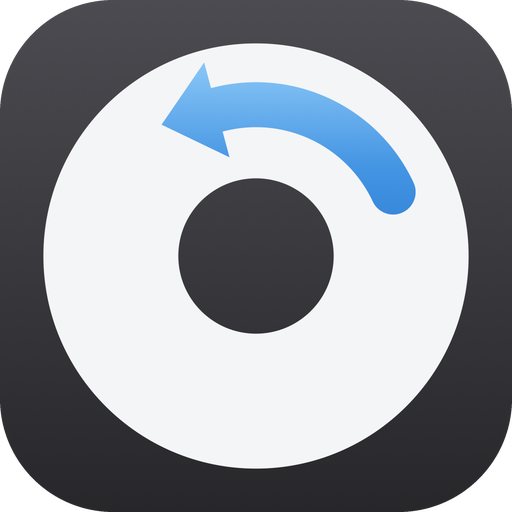
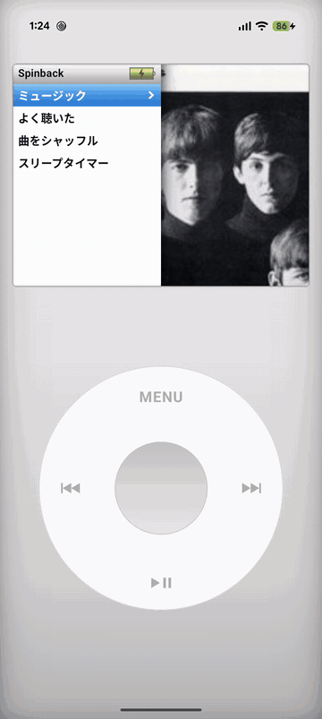

<div align="center">
  

  # Spinback

  **昔の iTunes ライブラリを、iPod classic の画面と操作で聴く Android 音楽プレーヤー**

  
  
  

  
</div>

音楽はストリーミングではなく、Mac の iTunes フォルダから書き出して、USB で端末にコピーします。再生回数、プレイリスト、当時のジャケットも一緒に持っていけます。

## 特徴

- **iPod classic の画面とクリックホイール**
  - ホームと「ミュージック」は、右半分にジャケットがゆっくり動きながら切り替わる表示
  - 再生中画面は、傾いたジャケットと映り込み、つやのあるシークバー
  - ホイールのクリック音と振動
  - 端末のダークモードに合わせて、ブラックとシルバーの外観を切り替え
- **日本語版 iPod と同じ並び順**: 英字 → かな → 漢字（JIS 順）→ 数字 → 記号だけの名前。カタカナとひらがなは区別せず、先頭の記号や「The」は無視します。iTunes で設定した「読み」（並べ替え用の名前）も使います。
- **iTunes のデータをそのまま**: 再生回数順の「よく聴いた」、iTunes / iPod で作ったプレイリスト（On-The-Go も含む）、`Album Artwork` キャッシュから取り出したジャケット
- **バックグラウンド再生**: ロック画面・通知・イヤホンからも操作できます（Media3）
- **スリープタイマー**: ホームの「スリープタイマー」で 15〜120 分を選ぶと、時間が来たところで再生を止めます。アプリを閉じていても止まります。

## 操作

| 操作 | 動き |
|---|---|
| ホイールを回す | 一覧の移動。再生中画面では音量 |
| 真ん中のボタン | 決定。再生中画面ではシーク（もう一度押すと戻る） |
| MENU | 1つ前の画面へ。1秒長押しでホームへ |
| ⏭ / ⏮ | 次の曲 / 曲の頭（頭付近なら前の曲）。長押しで早送り / 巻き戻し |
| ▶❙❙ | 再生 / 一時停止 |

## 必要なもの

- Android 15 以上の端末
- macOS（ライブラリの書き出しと転送に使います）
  - Python 3.10 以上
  - [Pillow](https://pypi.org/project/pillow/) と [cryptography](https://pypi.org/project/cryptography/)（ジャケットの取り出し用。なくても動きますが、ジャケットは曲ファイルに埋め込まれたものだけになります）
  - [ffmpeg](https://ffmpeg.org/)（Apple ロスレスの曲がある場合）
  - adb（Android Studio に含まれる Android SDK Platform-Tools）
- `iTunes Library.xml` が入った iTunes フォルダ

```sh
brew install ffmpeg
python3 -m pip install pillow cryptography
```

## 使い方

1. 設定ファイルを作り、iTunes フォルダの場所を書きます。

   ```sh
   cp tools/spinback.conf.example tools/spinback.conf
   ```

   | 設定 | 意味 | 既定値 |
   |---|---|---|
   | `SPINBACK_ITUNES_DIR` | `iTunes Library.xml` があるフォルダ | `~/Music/iTunes` |
   | `SPINBACK_EXPORT_DIR` | 端末に送る前の書き出し先 | `~/Spinback-export` |

   同じ名前の環境変数や、スクリプトのオプション（`--itunes`、`--out`）でも指定できます。

2. アプリを端末にインストールし、一度起動します。曲を置く保存領域は、最初の起動で作られます。Android Studio から実行するか、次のコマンドでインストールできます。

   ```sh
   ./gradlew installDebug
   ```

3. 端末を USB でつなぎ、ライブラリを書き出して転送します。

   ```sh
   ./tools/push_to_device.sh
   ```

   Apple ロスレスの曲を FLAC と AAC のどちらで入れるか聞かれます。2回目からは、追加・変更されたファイルだけが送られます。

4. アプリを起動し直します。

## 仕組み

`tools/export_library.py` が iTunes ライブラリを読み、次のものを書き出します。

```
<書き出し先>/library.json        曲情報・再生回数・プレイリスト
<書き出し先>/music/<id>.<拡張子>  曲ファイル
<書き出し先>/artwork/<id>.jpg     ジャケット
```

- **曲ファイル**: AAC と MP3 は元のファイルへのハードリンクなので、ディスクを余分に使わず、音質も変わりません。
- **Apple ロスレス**: Android は ALAC を再生できないため、ffmpeg で変換します。
  - FLAC: ロスレスのまま変換します。音声データは元とビット単位で一致します
  - AAC: 256kbps に変換します。容量は FLAC の約 1/4 です
- **ジャケット**: iTunes はジャケットの多くを、曲ファイルではなく `Album Artwork` フォルダの `.itc` / `.itc2` ファイルに保存しています。曲とジャケットの対応は、暗号化された `iTunes Library.itl` に記録されています。これを読んで、アルバムごとに一番大きい画像を書き出します（iTunes 11 以降の形式に対応）。
- Podcast と動画は書き出しません（Podcast は `--include-podcasts` で含められます）。

元の iTunes フォルダは読み込むだけで、変更しません。

## 注意

- 曲はアプリ専用の保存領域（内部ストレージの `Android/data/com.minagawer.spinback/files`）に置かれます。上書きインストールでは消えません。
- アンインストールすると、曲も一緒に消えます。
  - アンインストール時に「アプリデータを保持してください」にチェックを入れると、曲を残したままアプリだけを消せます。もう一度インストールすると、そのまま使えます。
  - ただし、残した曲は自動では消えず、ファイルアプリからも見えないまま容量を使い続けます。もう使わない場合はチェックを入れずにアンインストールするか、入れ直してからチェックなしでアンインストールしてください。Mac からは `adb shell rm -rf /sdcard/Android/data/com.minagawer.spinback` でも消せます。
- 複数の端末をつないでいるときは、`ANDROID_SERIAL=<シリアル番号> ./tools/push_to_device.sh` で転送先を選びます。

## テスト

```sh
./gradlew :app:testDebugUnitTest
```

## ライセンス

[MIT](LICENSE)

iPod、iTunes は Apple Inc. の商標です。Spinback は Apple とは関係のない個人のプロジェクトです。
